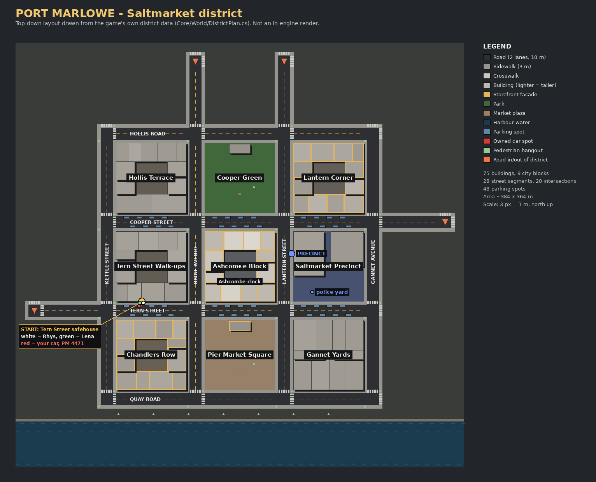

# Port Marlowe — current status

_Updated 2026‑10‑12. Branch `claude/m1-foundation`._

## Current-state note

| Item | Value |
| --- | --- |
| Editor | Unity 6000.6.5f1 (newest SUPPORTED/recommended), URP 17.6.0 |
| Project path | repository root (`Assets/PortMarlowe/…`) |
| Build action | `PortMarlowe.EditorTools.BuildTool.BuildFromCommandLine -pmProfile <LinuxDev\|WindowsDev\|UwpDiagnostic\|UwpRelease>` (see `BuildAndDeploy.md`) |
| Last verified package | **none.** No UWP package has been compiled. |
| Save schema | version 1 |
| Active task | M1 playable milestone: runtime review, then visual upgrades (CC0 PBR is wired) |
| Next dependency | A Unity licence secret on CI. It unlocks the editor tests, the player build, the smoke run, and the UWP export plus package. |

## Blockers

1. **No Unity licence available to automation.** The repository has no `UNITY_*` secrets, so CI jobs that run the editor are skipped:
   - EditMode/PlayMode tests;
   - the Linux player build and headless smoke run;
   - the Windows UWP export and MSBuild package.

   The jobs are written and wired to start as soon as secrets are added (`BuildAndDeploy.md` §6).
2. **No GPU on any available host.** The sandbox and GitHub's Linux runners have none. Graphical quality, GPU frame time, shader compilation results and ray tracing are **unverified**.
3. **The sandbox network blocks Unity and asset hosts**, including the Asset Store, Fab, Mixamo, Poly Haven, ambientCG and Freesound, as well as GitHub artifact storage.
   - Workaround in use: GitHub Actions runners fetch the CC0 sets. The files are pinned and hash-checked.
   - Still blocked: paid or licensed content, and any purchase (not approved).
4. **Xbox verification is deferred**, as requested. Hardware ray tracing on Xbox UWP is expected to be **unavailable** (feature level 11) and is marked unverified.

## What is verified, and how

| Evidence | Result |
| --- | --- |
| Core rules (crime, police, seats, switching, partner AI, saves, economy, district plan) | **79/79 NUnit tests pass** on CI (`core-tests`) |
| All project C# against the real Unity 6000.6.5f1 and package assemblies | **0 errors, 0 warnings**, editor and player passes (`unity-compile-check`). Covers Core, Runtime, EditorTools, Rendering.Urp (+Editor), EditMode and PlayMode tests. |
| CC0 surface sets: download, hash, convert | 10/10 sets on CI (`assets` workflow). Hashes are pinned in `Tools/Assets/cc0_lock.json`. |
| Editor import, scenes, PlayMode, autotest | Not run (blocker 1) |
| Desktop player | Not built (blocker 1) |
| UWP export / MSBuild package | Not built (blocker 1). **No installable package exists.** |
| Xbox device | Not tested (deferred) |

## District layout

This top-down layout is drawn from the game's own district data (`DistrictPlanner.CreateSaltmarket()`). It is **not** an in-engine render; no frame of the game has been rendered yet.

## Milestone 1 feature matrix

Column codes:

| Column | Meaning |
| --- | --- |
| Impl | Implementation state |
| Core | Rules covered by core unit tests |
| Compile | Compiles against the Unity APIs |
| Editor | Verified in the editor |
| Desktop | Verified in a desktop player |
| UWP build | Verified in a UWP build |
| Pkg | Package prepared |
| Xbox | Verified on the Xbox |

A dash means not yet.

| Feature | Impl | Core | Compile | Editor | Desktop | UWP build | Pkg | Xbox |
| --- | --- | --- | --- | --- | --- | --- | --- | --- |
| Connected district (Saltmarket: 4×4 streets, quay, park, 30+ buildings, safehouse, precinct) | implemented | ✔ plan validator | ✔ | – | – | – | – | – |
| Two protagonists (Rhys Calloway, Lena Duarte), 3 outfits each | implemented | – | ✔ | – | – | – | – | – |
| Third-person movement and camera (collision, profiles, Xbox controller map) | implemented | ✔ stick/locomotion | ✔ | – | – | – | – | – |
| Usable vehicle (owned Aldine Courier; parked cars; doors, seats, break-in, fuel, damage, lights, audio) | implemented | ✔ seats/fuel/damage/security | ✔ | – | – | – | – | – |
| Partner follow, board, hold, and switching | implemented | ✔ | ✔ | – | – | – | – | – |
| Pedestrians (budgeted, out-of-view spawning, perception, reactions, phone reports) | implemented | ✔ observation | ✔ | – | – | – | – | – |
| Ambient traffic (AI cars on lane routes; first pass, no signals) | implemented | – | ✔ | – | – | – | – | – |
| Minimap (camera-aligned; police shown only when seen/heard) | implemented | – | ✔ | – | – | – | – | – |
| Report-driven police (evidence pipeline, five stages, search, challenge, arrest) | implemented | ✔ | ✔ | – | – | – | – | – |
| Safehouse (door, bed rest + autosave, wardrobe) | implemented | – | ✔ | – | – | – | – | – |
| Save/load (manual + autosave, checksum, backup recovery, migration) | implemented | ✔ | ✔ | – | – | – | – | – |
| Title, pause, settings and controls menus; HUD (heat with reason, prompts, vehicle, clock) | implemented | – | ✔ | – | – | – | – | – |
| Time-of-day lighting, streetlight budget, URP post volume, quality profiles | implemented | – | ✔ | – | – | – | – | – |
| CC0 PBR surfaces with procedural fallback | implemented | – | ✔ | – | – | – | – | – |
| Diagnostics overlay + JSON report (frame times, memory, reported RT capability) | implemented | – | ✔ | – | – | – | – | – |
| Suspend → pause + autosave; controller disconnect → pause | implemented | – | ✔ | – | – | – | – | – |
| Automated smoke scenario (`-pmAutotest`) and PlayMode tests | implemented | – | ✔ | – | – | – | – | – |

Full subsystem coverage is in `SpecLedger.md` (PM‑001…070).

## Known gaps and issues

- All art is procedural or placeholder. There are no faces, no skeletal animation clips, one vehicle model, and no ambient traffic.
- One district, built at load. No streaming yet.
- No combat beyond a single strike, no full-screen map, no missions or activities. Traffic has no signals or intersection reservation yet.
- The URP setup step adds SSAO through a by-name feature lookup. It degrades to a warning if the package changes visibility.
- Generated assets and `.meta` files are only created on the first licensed editor run. They must be committed afterwards.
