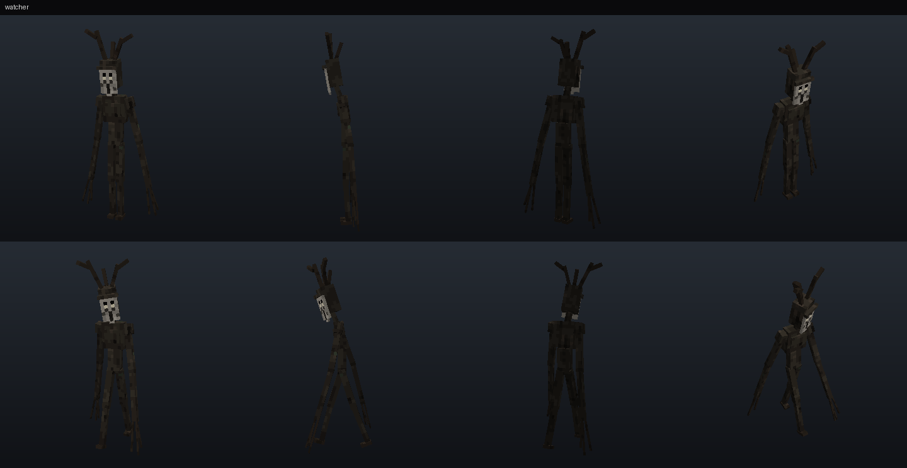
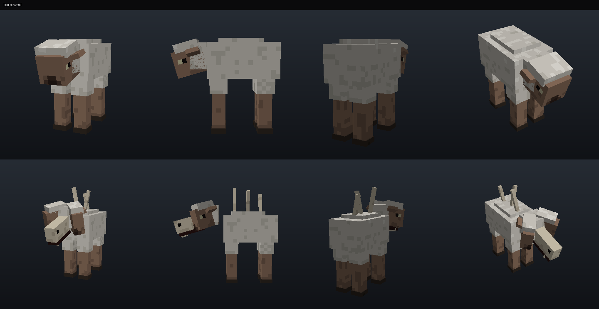
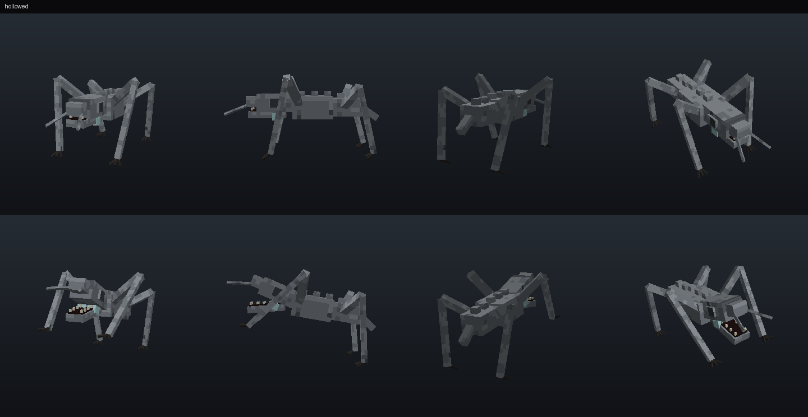
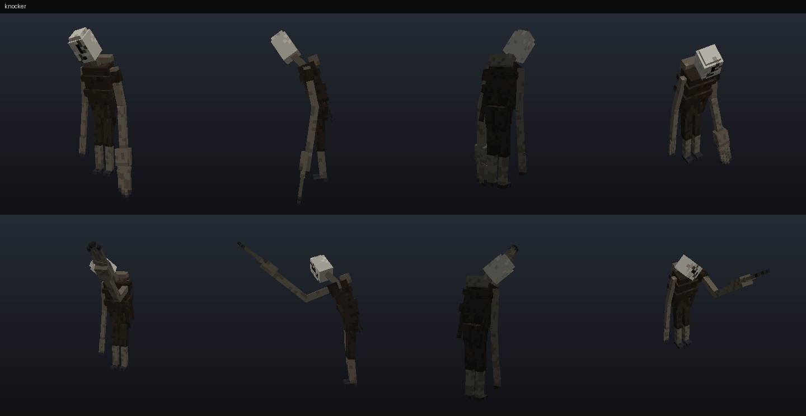
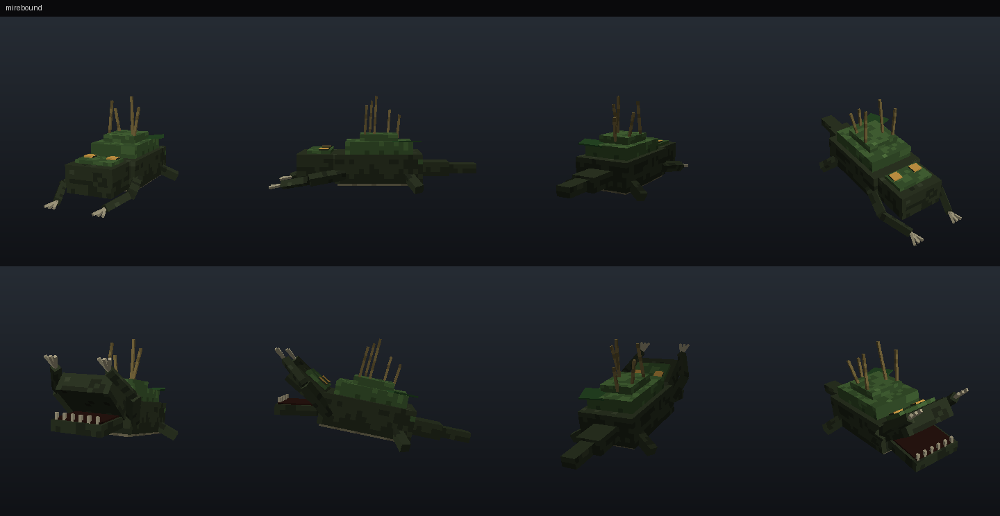
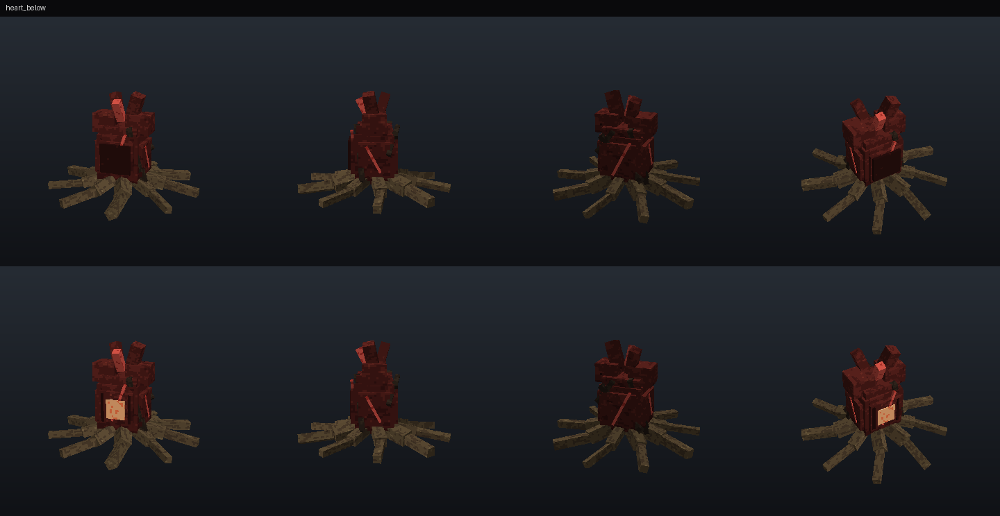

# Creature reference (design and implementation)

This is the developer and design view of each creature: assets, spawn rules, behavior states, balance, drops, cleanup
and counterplay. For the player-facing version, see the [Survival Guide](SURVIVAL_GUIDE.md).

**Shared rules for every creature**
- **One director:** each online player is evaluated every **5 s**, staggered so players don't share a tick
  (`systems/director.ts`). A player has at most **one major encounter** at a time (Watcher or Mirebound). Borrowed and
  Hollowed spawn independently, under their own caps.
- **Spawn gates:** survival or adventure mode only; never on Peaceful; never in a player's first **10 minutes** of play in
  the world; never within **1 minute of a respawn**; never inside a Heartwood Lantern's 24-block radius.
- **No pop-in, no teleporting:** spawns are placed **outside the player's line of sight** (script raycast) or out of their field
  of view. After spawning, every creature moves with its own engine pathfinding. Nothing teleports behind the player.
- **Cleanup:**
  - Encounter entities are tracked in script. Any `hollow:` entity that loads without a live encounter (after a reload,
    crash or chunk reload) is removed (`systems/cleanup.ts`).
  - Encounters end when their target leaves, dies or changes dimension.
  - Only the boss and its veins persist, and they're persisted deliberately.
- **Cooldowns** are per player and scaled by *intensity* and *frequency* (`cooldownScale`: Calm ×1.6, Standard ×1.0,
  Nightmare ×0.7, divided by frequency). Spawn chances scale by `chanceScale` (Calm ×0.55, Standard ×1.0, Nightmare ×1.5,
  times frequency).
- **Sounds** are positional world sounds at the creature, with per-player minimum gaps so cues never stack
  (`core/audio.ts`).

Previews below are **offline software renders** made by the build tools (`tools/hollowkit/render.py`) to check the
models. They are **not in-game screenshots**.

---

## The Watcher (`hollow:watcher`)

| | |
|---|---|
| Model | 2.9-block-tall bark-skinned figure with a pale face plate, a crown of dead twigs and over-long arms (`geometry.hollow.watcher`). At 40+ blocks it reads as a dead sapling until it moves. |
| Textures | Colour, MERS (emissive eye glints, rough bark), heightmap texture set; separate glow layer for standard graphics. |
| Animations | idle sway, walk, look_at_target, stare (head tilt), seen (flinch), lunge; locomotion and mood controllers. |
| Sounds | step, creak, seen, retreat, lunge, hurt, death (+ forest hush, distant stinger). |
| Stats | 40 HP, 5 melee damage (vanilla difficulty scaling), speed 0.30. |
| Drops | Pale Resin 1–2 (+Looting), sticks. Staring it down also leaves 1 Pale Resin (once per player per night; 2 on Nightmare). |

**Spawn rules:**
- Overworld, **forest-group biome**, dusk to dawn (time 12400–23400), player on the surface, not roofed and not in water.
- Base chance 10% per evaluation × `chanceScale`; cooldown 4–7 min.
- Placed 34–50 blocks away at 95–160° from the view direction, on forest ground, with no light block within 5 blocks
  and a clear line to the player's head.
- At most min(3, players) at once.
- During grace days it spawns in **glimpse** mode: it never stalks and leaves after 45 s.

**States** (`creatures/watcher.ts`, updated every 4 ticks):
- `lurk`: stands still at the treeline. Being watched adds to a stare counter: **24 ticks (1.2 s) of gaze → `withdraw`
  ("stared")**, which drops resin. If it's unobserved for 60 ticks (3 s) and the player isn't safe → `stalk`.
- `stalk`: approaches with pathfinding only while unobserved; any observer sends it back to `lurk`.
  - At ≤10 blocks a **twig-snap warning** plays at its position.
  - At ≤5 blocks, if it can strike → `lunge`; otherwise → `lurk`.
- `lunge`: one melee strike (the entity's `melee_attack`), then `withdraw` ("struck").
- `withdraw`: steps back, then vanishes once unobserved (or 40+ blocks away) after 3 s, and after 12 s at most.
- "Observed" means a player within 72 blocks whose view direction is within max(8°, atan(1.6/d)) of its head, with a
  clear block raycast to its head or chest. There's no fake detection.
- **Safe** (it won't stalk) means being within 6 blocks of placed light, under a roof, or near a Heartwood Lantern.
  Holding a torch or lantern stops the strike. A charged Rowan Ward within 10 blocks makes a stalking Watcher withdraw
  (spending one charge).
- It leaves at dawn, after 3 minutes, or beyond 96 blocks. It **never strikes on Calm**.

**Counterplay:** look at it; carry light; stay near placed light; ward.

---

## The Borrowed (`hollow:borrowed`)

| | |
|---|---|
| Model | Original sheep-proportioned geometry with legs a touch too long and the head carried a touch too low. The true form is built into the same rig: the head splits into two hinged halves around a pale inner skull, and three spines unfold from under the wool. |
| Textures | Disguise, true form, night eyeshine glow (`glow_night_borrowed` render controller: eyes only shine at night). |
| Animations | disguise (no grazing, pacing), idle, walk, look_at_target, reveal, revealed, attack, form, strike. |
| Sounds | baa, baa_wrong (bleat ending in a click), reveal, attack, hurt, death, step. |
| Stats | 24 HP, 5 damage, speed 0.23 disguised / 0.32 revealed / 0.34 fleeing. |
| Drops | Borrowed Hide 1–2 (+Looting), bone 50%. |

**Spawn rules:**
- Hollow day ≥1, Overworld surface.
- Needs an existing **flock of ≥2 sheep** 16–56 blocks away. It spawns next to a sheep the player can't currently see,
  at least 14 blocks from the player.
- Chance 4% by day / 12% at night × `chanceScale`; cooldown 10–15 min.
- At most min(2, players) at once, and one per target.

**States:**
- `disguised`: harmless. Shows tells every 35–70 s at night (wrong bleat 45%).
- It's revealed by: **shears** (custom `interact` → `hollow:sheared` event), being **hurt**, a **Rowan Ward** within
  10 blocks, or at night a player within 4 blocks, in the dark, without a light, for 2 s.
- The **Hollow Lens** reveals it *visually* to the lens user only (`setPropertyOverrideForEntity`). That's an
  investigation reveal and doesn't trigger the hunt.
- `revealed`: at night it hunts (melee); by day it flees.
- `fleeing`: below 40% HP, at dawn, or after a ward. It vanishes once out of range.
- In daylight, a disguised Borrowed older than 3 minutes with nobody within 24 blocks quietly leaves.

**Counterplay:** wheat test (it isn't tempted), shears, lens, ward; fight by day or with light.

---

## The Hollowed (`hollow:hollowed`)

| | |
|---|---|
| Model | Low, pale, eyeless cave predator: high spider-like elbows, a long skull with a hinged needle-toothed jaw, two feelers and paired echo-sacs on the throat. |
| Textures | Pale wet hide (MERS: wet specular, subsurface). The throat echo-sacs glow faintly (pale lights low to the ground in the dark). |
| Animations | idle, walk, click (throat), investigate (head sweep), attack, strike. |
| Sounds | click (echolocation), alert, sniff, step, attack, hurt, death; cave breath and shift ambience. |
| Stats | 26 HP, 6 damage, speed 0.26 / 0.30 investigating. Juveniles (boss minions): 10 HP, 3 damage. |
| Drops | Hollow Fang 1 (+Looting), bones 0–2. |

**Exactly what it detects** (`systems/noise.ts`). Only supported, observable game events are used.

| Source | Radius | API |
|---|---|---|
| Sprinting | 16 | `Player.isSprinting`, polled every 10 ticks only for players near a Hollowed |
| Walking (not sneaking) | 6 | horizontal velocity |
| Jumping / landing | 8 | `isJumping`, airborne → `isOnGround` |
| Breaking a block | 12 | `world.afterEvents.playerBreakBlock` |
| Placing a block | 8 | `playerPlaceBlock` |
| Doors, trapdoors, gates, chests, barrels | 10 | `playerInteractWithBlock` |
| Levers, buttons, pressure plates, tripwire, pistons | 10 | `leverAction`, `buttonPush`, `pressurePlatePush`, `tripWireTrip`, `pistonActivate` |
| Fighting (hurt involving a player) | 14 | `entityHurt` |
| Explosions | 40 | `explosion` |
| Projectiles landing | 12 | `projectileHitBlock`, `projectileHitEntity` (at the impact point) |

**Silent:** sneaking, standing still, and walking on any wool or carpet. **No microphone or voice input is used.**
Within 3 blocks it finds a player regardless (`nearest_attackable_target` with a short range).

**Spawn rules:**
- Hollow day ≥ grace days, player underground, Y ≤ 0 (Y ≤ 40 from day 4).
- Chance 15% × `chanceScale`; cooldown 2.5–4 min.
- Spawned 18–30 blocks away on dark ground (light ≤3, no light block within 6), **out of line of sight**.
- At most 2 within 48 blocks of the player (3 on Nightmare), and 6 in the world.

**States:**
- `calm`: wanders and clicks.
- A heard noise within radius → `investigate`. A temporary invisible **lure** entity
  (`hollow:lure`, family `hollow_temp`) is placed at the noise. The Hollowed targets it with normal pathfinding,
  then sniffs.
- Lures expire after 10 s. A Hollowed with no player within 64 blocks for 30 s is removed.

**Counterplay:** sneak; wool and carpet floors; throw projectiles as decoys; keep light around; keep distance.

---

## The Knocker (`hollow:knocker`)

| | |
|---|---|
| Model | A hunched visitor wrapped in rags, with a cracked porcelain face that lists to one side and one enormous knuckled hand made for knocking. |
| Textures | Rags, skin and porcelain (MERS roughness per material). No glow: it's meant to be heard, not seen. |
| Animations | idle, walk, knock (arm swing synced to the knock timeline), hunt, attack, look_at_target, strike. |
| Sounds | knock (modal wood, three-knock pattern), scratch (stick-slip), breath, step, lunge, hurt, death, leave. |
| Stats | 60 HP, 7 damage, speed 0.22 / 0.27 hunting. |
| Drops | Knocker's Nail 2–3 (+Looting), iron nuggets 2–5, string 50%. Leaving unanswered drops 1 Nail on the step. |

**Spawn rules:**
- **Each night is decided once**, at sunset: eligible if the Knocker is enabled, night ≥ *First Knocker night*
  (default 4), and enough nights since the last visit (3 / 2 / 1 on Calm / Standard / Nightmare).
  Chance min(90%, 45% × `chanceScale`). A random time between 13600 and 19000 is chosen.
- At that time it picks one eligible player: **inside a roofed shelter** with a door within 10 blocks, not a newcomer,
  and no Heartwood Lantern nearby.
- It spawns 18–26 blocks outside the door (the side with sky light), out of line of sight.
- **At most one visit per night in the whole world.**

**States** (`creatures/knocker.ts`):
- `approach`: walks to the door with `move_to_block` pathfinding.
  - A charged Rowan Ward within 10 blocks of the door → turned away (one charge), then `leave`.
- `knock`: a 45 s scripted timeline of knock, knock, scratch, breath, knock, scratch. It can't open doors.
  - Unanswered → leaves a Nail on the step, then `leave`.
  - Optional **Destructive Knocker** (operator setting, **off by default**): only on **Hard**, after 30 s, with a 5% chance
    per check, it may try once to break a **wooden** door with vanilla `break_door` rules.
- Door opened during `knock` → `hunt` (melee). It leaves when below 25% HP, after 90 s, or at daybreak.
- `leave`: walks away and is removed once 40+ blocks from every player, or after 30 s.

**Counterplay:** don't answer; ward by the door; Heartwood Lantern; iron doors.

---

## The Mirebound (`hollow:mirebound`)

| | |
|---|---|
| Model | Broad, low ambusher whose back is a mossy hump of reeds and pads (a rotten log in the shallows). When it erupts, a wide flat head with a huge hinged jaw rises and two long grasping arms unfold. Amber eyes sit on top of the head. |
| Textures | Moss and mud (MERS: wet, subsurface); the amber eyes glow at night only. |
| Animations | lurk (submerged bob), erupt (rear-up windup), grab, swim. |
| Sounds | bubble, gurgle, erupt, grab, release, hurt, death; swamp gurgle and creak ambience. |
| Stats | 30 HP, 4 damage, speed 0.12 (slow on land). |
| Drops | Mire Pearl 1 (+Looting), slime ball or kelp. |

**Spawn rules:**
- Hollow day ≥2, swamp-group or shore-group biome (swamps, mangroves, rivers, beaches).
- Chance 3% by day / 12% at night × `chanceScale`; cooldown 6–9 min.
- Spawned in **1–2-block-deep water**, 10–22 blocks ahead of the player (±55°) and at least 8 blocks away.
- At most min(3, players) at once.

**States:**
- `lurk`: submerged hump with bubbles and a gurgle as clues (every few seconds while a player is near) and eyes at night.
- `erupt`: a player within 3.5 blocks → a **12-tick (0.6 s) windup**, the escape window.
- `grab`: the player is seated on its `rideable` seat under the surface. Takes 2 damage every 1.5 s, with a **"Press SNEAK"**
  prompt.
  - It releases on sneak, on being hit, on death, or after 5 s.
  - Fallback: if the platform refuses forced riding, the grab becomes a bite (3 damage) plus 2.5 s of slowness.
- `retreat`: swims off. It settles again (at most 2 grabs per encounter) or leaves.
- It's removed after 60 s with no players near, or after 5 minutes.

**Counterplay:** read the clues; walk banks; sneak to break free; hit it.

---

## The Heart Below (`hollow:heart_below`), boss

| | |
|---|---|
| Model | A huge root-bound heart that opens in phase 3. Veins (`hollow:heart_vein`) cling to the pillars. Root spikes (`hollow:root_spike`) are the visible attack telegraph. |
| Textures | Flesh and root (MERS: wet subsurface, emissive vein glow); the shield is shown with a render-controller overlay. |
| Animations | beat (speed by phase), roots, open, mood; vein pulse; spike rise. |
| Sounds | beat, beat_fast, awaken, drone, root_warn, root_strike, pulse, phase, hurt, death, vein_break, spawn. |
| Stats | 300 HP; 480 / 660 / 840 with 2 / 3 / 4+ players. Veins 30 HP (45 with 3+ players). Boss bar via `minecraft:boss`. |
| Drops | Every participant: 1 Stilled Heart + 150 XP (once per kill). Shared: diamonds 2–4, gold 4–8, golden apple, XP bottles 3–6. |

**Awakening:** only by a player using an **Offering of Silence** on the shrine altar. It doesn't respond while the
altar rests (3 days after a kill). The heart spawns 6 s after the offering, with fog and a title.

**Attacks** (all telegraphed, all avoidable):
- **Root burst**, one per player: dust and a rumble at the player's feet, then the hit 24 ticks (1.2 s) later for
  6 damage within 1.7 blocks.
- **Pulse ring**: expands at 9 blocks/s along the floor and deals 5 damage only to grounded players.
  Jump it. The interval is 12 s, 10 s and 9 s in phases 1, 2 and 3.
- **Gaze** (phase 3): a 13-step sweep with a line-of-sight check, 3 damage plus slowness. Pillars block it.

**Phases:**
1. Shielded until all 4 veins are broken.
2. At 60%: the shield returns, 3 veins regrow (once), and 2 + players juvenile Hollowed spawn (max 5).
3. At 25%: it opens. Faster bursts and the gaze.

**Safety:**
- Dormancy after 60 s with nobody in the arena: the Heart is removed and **the Offering is returned**.
- Rewards are recorded per participant and paid once.
- Boss state is persisted in a world dynamic property, so a reload mid-fight resumes it.
